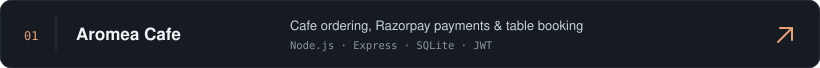
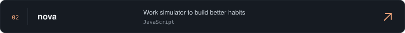
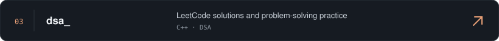
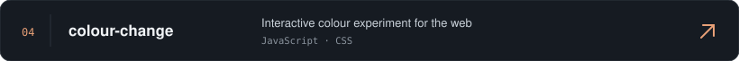

 

&nbsp;
&nbsp;

## About

  

## Selected projects

## Tech stack

**Languages & frontend**

**Backend, data & tools**

## Contributions

  

  

<i>"Small steps every day add up to something big."</i>

